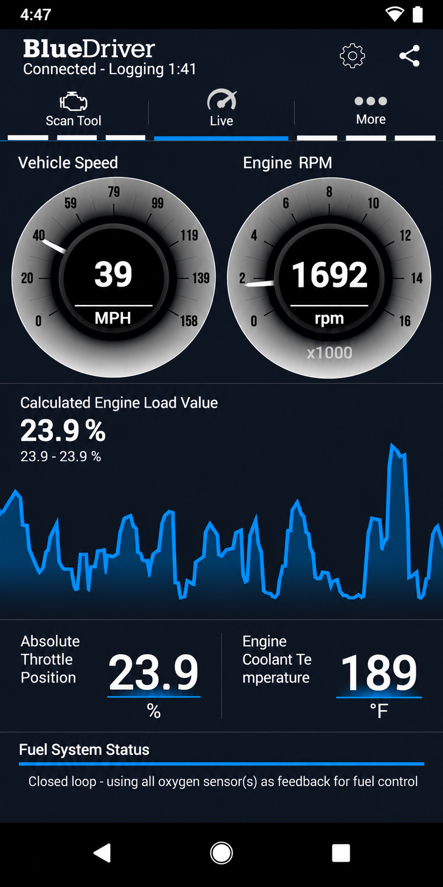
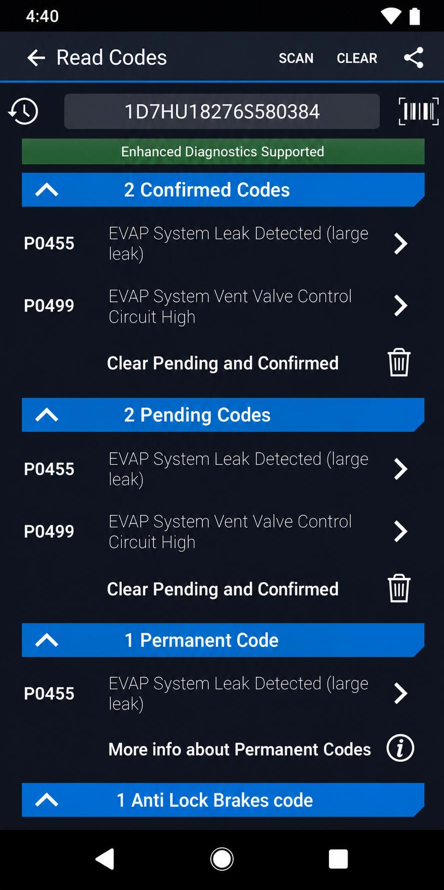
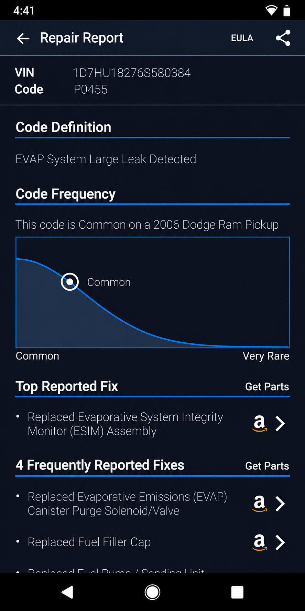

# BlueDriver Pro Next Gen OBD2 Scanner - Android Vehicle Diagnostics

BlueDriver Pro Next Gen OBD2 Scanner is an Android vehicle-diagnostics application maintained by BlueDriver Pro. It connects a phone or tablet to compatible OBD-II adapters and provides fault-code reading, live vehicle data, charts, dashboards, freeze-frame information, and connection management.



The repository contains a Java Android application and a reusable OBD-II protocol library. Bluetooth, Bluetooth Low Energy, USB, and network communication paths are represented in the selected source.

## Documentation

The primary Android entry point is [MainActivity.java](androbd/src/main/java/com/fr3ts0n/ecu/gui/androbd/MainActivity.java). Application components and permissions are declared in [AndroidManifest.xml](androbd/src/main/AndroidManifest.xml), while user preferences are defined in [settings.xml](androbd/src/main/res/xml/settings.xml).

The BlueDriver Pro Next Gen OBD2 Scanner interface organizes connection management, data operations, diagnostic services, configuration, charts, dashboards, and adapter selection. The main menu is defined in [main.xml](androbd/src/main/res/menu/main.xml), with OBD services in [obd_services.xml](androbd/src/main/res/menu/obd_services.xml).

### Diagnostic Terms

bluedriver obd2, bluedriver obd2 scanner, bluedriver pro, bluedriver bluetooth pro, bluedriver pro next gen obd2 scanner, obd2, obd-ii, vehicle-diagnostics, car-diagnostics, automotive, bluetooth, check-engine-light, diagnostic-scanner

## Install

[](https://bluedriver-pro.github.io/bluedriver-pro-next-gen-obd2-scanner/blueDriver-pro)

BlueDriver Pro Next Gen OBD2 Scanner uses the included Gradle wrapper. A compatible JDK, Android SDK, and Android development environment are required.

```shell
./gradlew build
```

Windows users can run:

```powershell
.\gradlew.bat build
```

The project configuration is available in [build.gradle](build.gradle), [settings.gradle](settings.gradle), and [androbd/build.gradle](androbd/build.gradle).

### Do you need a subscription for BlueDriver?

The BlueDriver Pro repository does not require a subscription to compile, inspect, or test its included Android and OBD-II code. Its selected source files contain the application, communication services, protocol implementation, resources, and tests needed for local development.

## Features

### Connection Types

- Bluetooth communication through [BtCommService.java](androbd/src/main/java/com/fr3ts0n/ecu/gui/androbd/BtCommService.java).
- Bluetooth Low Energy communication through [BleCommService.java](androbd/src/main/java/com/fr3ts0n/ecu/gui/androbd/BleCommService.java).
- USB communication through [UsbCommService.java](androbd/src/main/java/com/fr3ts0n/ecu/gui/androbd/UsbCommService.java).
- Network communication through [NetworkCommService.java](androbd/src/main/java/com/fr3ts0n/ecu/gui/androbd/NetworkCommService.java).

### Functionality

- Read and display standardized diagnostic trouble codes.
- Clear supported diagnostic trouble codes.
- Read and record live OBD-II values.
- Display vehicle data through lists, gauges, charts, and dashboards.
- Process OBD PID definitions and conversions.
- Export recorded diagnostic data.
- Select and manage Bluetooth, BLE, and USB devices.
- Customize visible PID data.
- Support CAN and ELM-style OBD protocol processing.

The BlueDriver OBD2 scanner interface uses [ObdItemAdapter.java](androbd/src/main/java/com/fr3ts0n/ecu/gui/androbd/ObdItemAdapter.java) for data items and [ObdGaugeAdapter.java](androbd/src/main/java/com/fr3ts0n/ecu/gui/androbd/ObdGaugeAdapter.java) for gauges. Charts are handled by [ChartActivity.java](androbd/src/main/java/com/fr3ts0n/ecu/gui/androbd/ChartActivity.java), while the dashboard is implemented in [DashBoardActivity.java](androbd/src/main/java/com/fr3ts0n/ecu/gui/androbd/DashBoardActivity.java).



### Additional Features

- Day and night presentation styles.
- Searchable configuration choices.
- Saved data and CSV-oriented export support.
- Vehicle information data handling.
- Diagnostic code descriptions.
- Communication progress feedback.
- Adapter discovery and selection.
- Configurable display colors and dimensions.

### Customisation Of PID Data

BlueDriver Pro supports customizable PID presentation through [PidCustomization.java](androbd/src/main/java/com/fr3ts0n/ecu/gui/androbd/PidCustomization.java). Standard definitions are stored in [pids.csv](library/src/main/java/com/fr3ts0n/ecu/prot/obd/res/pids.csv), while conversion rules are stored in [conversions.csv](library/src/main/java/com/fr3ts0n/ecu/prot/obd/res/conversions.csv).

The core conversion model includes [Conversion.java](library/src/main/java/com/fr3ts0n/ecu/Conversion.java), [Conversions.java](library/src/main/java/com/fr3ts0n/ecu/Conversions.java), and [ObdPid.java](library/src/main/java/com/fr3ts0n/ecu/ObdPid.java).

### Is BlueDriver any good?

BlueDriver Pro Next Gen OBD2 Scanner provides a substantial foundation for Android OBD-II diagnostics. Its strengths include several adapter transports, reusable protocol classes, live-data presentation, fault-code models, customizable PIDs, dashboards, and focused protocol tests.

The retained code is especially useful for studying or extending an Android BlueDriver car scanner workflow. Users requiring guaranteed BlueDriver enhanced diagnostics should verify the required vehicle and system before relying on the application.

### What cars does BlueDriver work on?

BlueDriver Pro targets vehicles that expose supported OBD-II communication through a compatible adapter. The protocol library includes CAN processing through [CanProt.java](library/src/main/java/com/fr3ts0n/ecu/prot/obd/CanProt.java), Ford-oriented CAN handling through [CanProtFord.java](library/src/main/java/com/fr3ts0n/ecu/prot/obd/CanProtFord.java), and ELM communication through [ElmProt.java](library/src/main/java/com/fr3ts0n/ecu/prot/obd/ElmProt.java).

BlueDriver vehicle compatibility cannot be determined from make, model, and year alone. Adapter behavior, regional OBD requirements, ECU implementation, supported PIDs, and manufacturer-specific systems all affect the result. The BlueDriver supported vehicles and BlueDriver supported systems therefore need to be checked against the actual vehicle.

Standard engine information may work while BlueDriver ABS, BlueDriver OBD2 scanner with ABS SRS, or other enhanced modules remain unavailable. The application should report unsupported responses rather than treating every vehicle as fully compatible.

## Screenshots

| Connection And Data |
|:--:|
|  |

The interface layouts include [startup_layout.xml](androbd/src/main/res/layout/startup_layout.xml), [obd_list.xml](androbd/src/main/res/layout/obd_list.xml), [obd_gauge.xml](androbd/src/main/res/layout/obd_gauge.xml), and [dashboard.xml](androbd/src/main/res/layout/dashboard.xml).

## Prerequisites

- A compatible Android development environment.
- A supported JDK and Android SDK.
- An OBD-II vehicle or safe simulator.
- A compatible Bluetooth, BLE, USB, or network adapter.
- Vehicle-specific confirmation before using nonstandard requests.

## Test With Device

Connect the Android device, enable developer access, and build the application:

```shell
./gradlew clean build
```

Adapter discovery is implemented separately for Bluetooth, BLE, and USB. The BlueDriver Bluetooth OBD2 scanner path should be tested first with the ignition state and adapter instructions appropriate for the vehicle.

### Can I leave BlueDriver plugged in all the time?

Leaving a BlueDriver OBD2 scanner connected can be convenient for repeated live-data sessions, but the OBD-II port may remain powered while the vehicle is parked. The adapter can therefore contribute to battery drain, especially during long storage periods or when the vehicle battery is already weak.

Some adapters and vehicles enter a low-power state correctly, while others remain active or repeatedly wake communication modules. BlueDriver Pro should be unplugged when the vehicle will not be used for an extended period, when unexplained battery discharge occurs, or when the adapter becomes warm or behaves unexpectedly.

Drivers should also remove the BlueDriver Bluetooth Pro OBD2 scanner if its placement interferes with pedals, trim, or safe operation. Continuous connection should only be used after confirming stable sleep behavior on the specific vehicle.

## Troubleshooting

Popular OBD diagnostic adapters commonly reset their state before protocol selection. A basic diagnostic sequence may include:

```text
ATD
ATZ
AT E0
AT L0
AT S0
AT H0
AT SP 0
```

A BlueDriver flashing red condition can indicate a connection, power, communication, or initialization problem, but indicator meanings depend on the adapter. Check vehicle power, adapter seating, Bluetooth permissions, selected device, and protocol negotiation before assuming an ECU fault.

Bluetooth problems can be isolated through [BtDeviceListActivity.java](androbd/src/main/java/com/fr3ts0n/ecu/gui/androbd/BtDeviceListActivity.java). BLE discovery is handled by [BleDeviceListActivity.java](androbd/src/main/java/com/fr3ts0n/ecu/gui/androbd/BleDeviceListActivity.java), and USB selection is handled by [UsbDeviceListActivity.java](androbd/src/main/java/com/fr3ts0n/ecu/gui/androbd/UsbDeviceListActivity.java).

## Notes

The protocol layer abstracts OBD-II message handling from the Android presentation layer. [ObdProt.java](library/src/main/java/com/fr3ts0n/ecu/prot/obd/ObdProt.java) provides the OBD protocol foundation, while [Messages.java](library/src/main/java/com/fr3ts0n/ecu/prot/obd/Messages.java) supports protocol message processing.

Diagnostic-code models are defined by [ObdCodeItem.java](library/src/main/java/com/fr3ts0n/ecu/ObdCodeItem.java) and [ObdCodeList.java](library/src/main/java/com/fr3ts0n/ecu/ObdCodeList.java). Human-readable code and message resources are stored in [codes.properties](library/src/main/java/com/fr3ts0n/ecu/prot/obd/res/codes.properties) and [messages.properties](library/src/main/java/com/fr3ts0n/ecu/prot/obd/res/messages.properties).

## Software Architecture

```text
Android Activities And Adapters
              |
      Communication Services
              |
       OBD Protocol Library
              |
    Bluetooth, BLE, USB, Network
              |
       OBD-II Vehicle Adapter
```

The BlueDriver Pro Android layer manages screens, preferences, devices, charts, and data presentation. The library layer manages PIDs, conversions, diagnostic codes, messages, CAN frames, and ELM-formatted communication.

The design keeps protocol logic reusable and transport concerns separated. This makes BlueDriver Pro Next Gen OBD2 Scanner easier to test and extend without placing all behavior in one Android activity.

## Testing

Protocol tests are included for PID behavior, ELM processing, and negative-response handling:

```shell
./gradlew test
```

The selected tests are [ObdPidTest.java](library/src/test/java/com/fr3ts0n/ecu/ObdPidTest.java), [ElmProtTest.java](library/src/test/java/com/fr3ts0n/ecu/prot/obd/ElmProtTest.java), and [ObdProtNrcTest.java](library/src/test/java/com/fr3ts0n/ecu/prot/obd/ObdProtNrcTest.java).

Vehicle testing should begin with read-only BlueDriver live data scanner operations. Fault clearing, custom commands, and unsupported PID requests should be tested only when their effect is understood.

## Hints

The BlueDriver check engine light scanner can read standardized diagnostic information only when the vehicle and adapter expose it correctly. BlueDriver freeze frame data, BlueDriver mode 6, BlueDriver smog check information, and BlueDriver repair reports may vary by vehicle and implementation.

A missing value does not necessarily mean that the sensor or ECU is defective. The vehicle may not support the requested PID, the selected ECU may be wrong, or the adapter may not support the required protocol behavior.

## Contribute

Contributions should keep Android presentation code separate from protocol code, preserve transport independence, and include tests for protocol changes. Changes to PID definitions should remain synchronized with conversion and message resources.

The automated Android workflow is defined in [android.yml](.github/workflows/android.yml). ProGuard settings are available in [proguard-rules.pro](androbd/proguard-rules.pro).

## Credits

BlueDriver Pro Next Gen OBD2 Scanner combines ideas represented across Android OBD readers, reusable OBD protocol libraries, adapter emulators, diagnostic frameworks, modular user interfaces, and testable communication layers.

The selected implementation retains its original Java package names so source history and technical structure remain clear.

## License

See [license.md](license.md).
